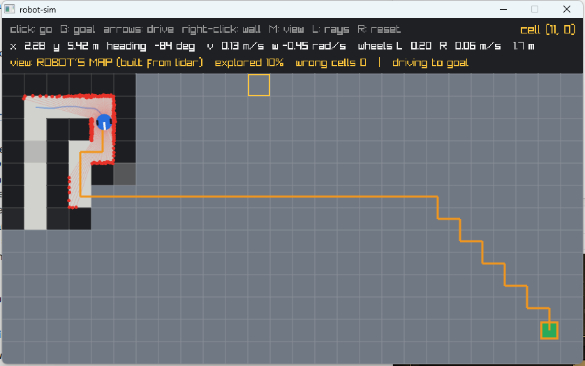

# robot-sim

[](https://github.com/Turnedone/robot-sim/actions/workflows/ci.yml)
[](LICENSE)

A 2D mobile-robot simulator in modern C++ (C++17) that implements a small but complete
**autonomy stack** from scratch: a differential-drive robot with a noisy lidar builds its
own map, plans a path on it, and drives there — starting from knowing nothing.



*The robot (blue) has only mapped its corner of a maze (white = free, black = wall,
grey = never seen). The orange line is its current A\* plan, which goes optimistically
through unknown space and is re-planned five times a second as the lidar reveals walls.*

## What it does

| Stage | What the robot can do | Main ideas | Docs |
|---|---|---|---|
| Motion | Drives like a real two-wheeled robot | Differential-drive kinematics, exact arc integration, wheel speed/acceleration limits, fixed-timestep simulation | [01-motion](docs/01-motion.md) |
| Sensing | Sees the world with a simulated 2D lidar | DDA ray casting, sensor noise model, dropouts, range limits, sensor frames | [02-lidar](docs/02-lidar.md) |
| Mapping | Builds its own map from noisy scans | Occupancy grid, log-odds Bayesian updates, per-scan voting, usable range | [03-mapping](docs/03-mapping.md) |
| Planning & control | Goes anywhere you click, re-planning as it learns | A\* on the robot's own map, optimistic planning, pure pursuit, arc collision checking | [04-planning-control](docs/04-planning-control.md) |
| Localization | Knows where it is although its wheels slip; finds itself from nothing; recovers when kidnapped | Odometry drift, particle filter (Monte Carlo localization, as in AMCL), likelihood field, adaptive particle count, ray-cast health check | [05-localization](docs/05-localization.md) |
| SLAM | Maps a building it has never seen and localizes in it at the same time, with slipping wheels | Rao-Blackwellized particle filter (as in GMapping): per-particle maps, scan matching, odometry prior, corridor problem | [07-slam](docs/07-slam.md) |
| ROS 2 + Gazebo | The same core as ROS 2 nodes; **our localizer and navigator drive a TurtleBot3 in Gazebo** in place of AMCL and Nav2 (under 5 cm localization error) | Topics, TF tree, `/cmd_vel`, `/scan`, `/odom`, `/map`, `/goal_pose`; inflation and path smoothing for 5 cm maps; WSL2 setup | [06-ros2](docs/06-ros2.md) |

How it was debugged — the problems the tests found and how each was tracked down — is in the
[engineering log](docs/engineering-log.md). The [devlog](docs/devlog.md) tells the whole story stage by stage. Questions to check your understanding are in the
[self-test](docs/self-test.md).

## Design

```
            robot_core  (no graphics, unit-tested)                   robot_sim (viewer)
 ┌────────────────────────────────────────────────────────────┐    ┌─────────────────┐
 │ grid       the true world, map frame (meters, y up)        │    │ raylib window   │
 │ robot      DiffDriveRobot: kinematics, limits, bumper      │    │ keyboard/mouse  │
 │ lidar      castRay (DDA), Lidar: noise, dropouts, ranges   │ ◄──│ draws whatever  │
 │ occupancy  OccupancyMap: log-odds mapping from scans       │    │ the core        │
 │ planner    A* on the OccupancyMap                          │    │ produces        │
 │ controller PurePursuit path follower                       │    └─────────────────┘
 │ navigator  Navigator: re-plan on every scan, safety check  │
 │ odometry   dead reckoning from the wheel encoders          │    ┌─────────────────┐
 │ particle_  ParticleFilter: Monte Carlo localization        │ ◄──│ ros2/ ROS 2     │
 │ slam       GridSlam: mapping + localization together       │    │                 │
 │   filter                                                   │    │ nodes (Jazzy)   │
 └────────────────────────────────────────────────────────────┘    └─────────────────┘
```

The robot logic (`robot_core`) knows nothing about graphics; the viewer only draws what the
logic produces. That keeps the logic testable on its own, and lets the same code run unchanged
inside ROS 2 nodes ([`ros2/`](ros2/robot_sim_ros)), with RViz replacing the viewer. The structure mirrors ROS conventions
on purpose: `Twist` commands (like `/cmd_vel`), a `LaserScan` with the same fields as
`sensor_msgs/LaserScan`, a map frame with y up (REP 103), and a planner/controller split like Nav2.

## Build and run

Needs a C++17 compiler and CMake ≥ 3.25. raylib (for the window) is downloaded automatically.

```bash
cmake -S . -B build
cmake --build build
./build/robot_sim                      # warehouse map
./build/robot_sim maps/maze.txt --go   # maze, robot sets off for the goal by itself
./build/robot_sim --text               # print the map in the terminal instead
./build/robot_sim --localize --go      # slipping wheels; the robot localizes with a particle filter
./build/robot_sim --global --go        # ...starting with no idea where it is (press K to kidnap it)
./build/robot_sim maps/maze.txt --slam --go   # no map and slipping wheels: SLAM
```

On Windows with MinGW add `-G "MinGW Makefiles"` (or `-G Ninja`) to the first command; with Visual Studio no extra options are needed.

### Controls

| Input | Action |
|---|---|
| left click | send the robot to that cell |
| G | send the robot to the map's goal (green) |
| arrow keys | drive by hand (cancels any goal) |
| right click | add / remove a wall — the robot's map catches up as it sees the change |
| M | switch view: robot's map / true map / lidar only |
| L | show / hide lidar rays |
| R | reset |

The header shows the robot's pose and wheel speeds, how much of the map it has explored,
and how many cells it has **wrong** (sure about, but the opposite of reality) — this stays at 0.

## Tests

108 [GoogleTest](https://github.com/google/googletest) tests, a few seconds in a release build:

```bash
ctest --test-dir build --output-on-failure
```

| File | Checks |
|---|---|
| [`test_robot`](tests/test_robot.cpp) | Motion against hand-worked answers: straight lines, spins, exact arcs, speed caps keep curvature, acceleration, bumper, angle wrapping, map frame |
| [`test_lidar`](tests/test_lidar.cpp) | Ray distances (straight, diagonal, off-centre), range limits, noise statistics, repeatability with a fixed seed |
| [`test_mapping`](tests/test_mapping.cpp) | Log-odds maths, one scan is not enough, hidden and out-of-range cells stay unknown, removed obstacles fade, a noisy lidar maps a room with zero wrong cells |
| [`test_planner`](tests/test_planner.cpp) | A\*: gaps, walled-in goals, no corner cutting, preferring known space |
| [`test_navigation`](tests/test_navigation.cpp) | The **whole robot closing the loop**: on both maps, 10 runs each with different sensor noise, it must reach the goal every time without touching a wall |
| [`test_localization`](tests/test_localization.cpp) | Odometry exact without slip and drifting with it; the filter tracks the pose while odometry drifts, finds itself with no starting guess, recovers from kidnapping, and navigates both maps on its own estimate (10 seeds each) |
| [`test_slam`](tests/test_slam.cpp) | Scan matching recovers an offset pose; on both maps SLAM keeps the pose within 15 cm and the map nearly perfect while odometry-based mapping is badly wrong; and the robot explores to the goal with no map, using only its SLAM estimate (5 seeds each) |
| [`ros2/…/test`](ros2/robot_sim_ros/test) | ROS 2: message conversions, and the simulator, localizer and navigator nodes driving the robot to a goal over real topics and TF (runs in CI in the `ros:jazzy` container) |

## Development

| CMake option | Default | |
|---|---|---|
| `ROBOT_SIM_BUILD_VIEWER` | ON | the raylib viewer; turn off to build only the logic and tests (no display libraries needed) |
| `ROBOT_SIM_BUILD_TESTS` | ON | GoogleTest is downloaded automatically |
| `ROBOT_SIM_WERROR` | OFF | treat warnings as errors (CI turns it on for GCC and Clang) |
| `ROBOT_SIM_SANITIZE` | OFF | AddressSanitizer + UndefinedBehaviorSanitizer (GCC/Clang) |

Code is formatted with clang-format and checked with clang-tidy; both are pinned to 23.1.3 so local
results match CI (`pip install clang-format==23.1.3 clang-tidy==23.1.3`):

```bash
clang-format -i src/*.cpp src/*.hpp tests/*.cpp
clang-tidy -p build src/*.cpp tests/*.cpp
```

**Continuous integration** ([`.github/workflows/ci.yml`](.github/workflows/ci.yml)) runs on every push:
build and test on Linux (GCC and Clang, warnings as errors) and Windows (MSVC), the tests again under
AddressSanitizer + UBSan, a formatting check, clang-tidy, and the ROS 2 package built and tested in the
official `ros:jazzy` container.

## Maps

Plain text: `#` wall, `.` free, `S` start, `G` goal; one character = one 0.5 m cell.
See [maps/](maps).

## Known limitations and next steps

- **Bigger worlds.** SLAM assumes the map size is known and copies a full map per particle; large areas need growing maps and pose-graph SLAM (Cartographer, slam_toolbox).
- **Path smoothing.** A\* paths on a grid have many small corners; the controller stops and turns at each one, which is safe in narrow corridors but slow in open space. Line-of-sight smoothing would fix this.
- **Gazebo / Nav2.** The ROS 2 nodes use standard topics, so they could be swapped for or compared with Gazebo and Nav2.

## License

[MIT](LICENSE).
