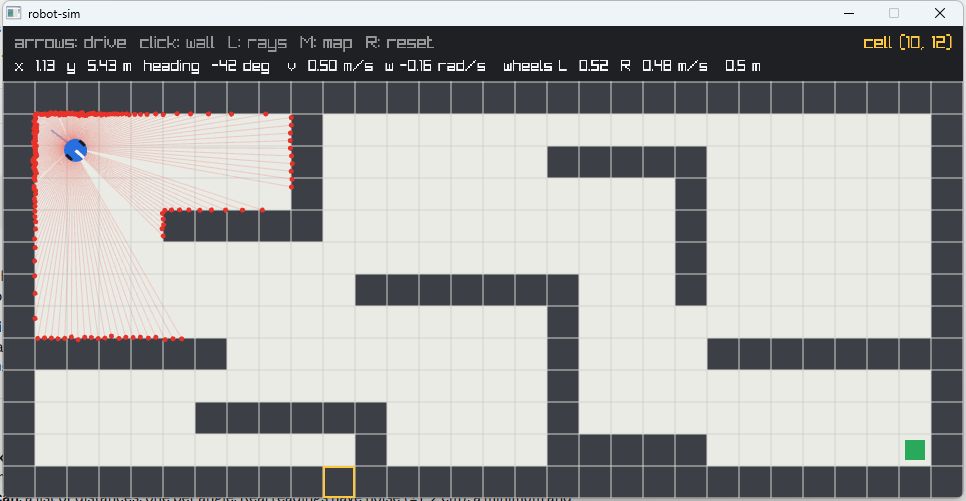

# 2. Sensing: a simulated 2D lidar

Code: [`src/lidar.hpp`](../src/lidar.hpp), [`src/lidar.cpp`](../src/lidar.cpp),
[`src/raycast.hpp`](../src/raycast.hpp) · Tests: [`tests/test_lidar.cpp`](../tests/test_lidar.cpp)



## What a 2D lidar does

A laser spins (the TurtleBot3's LDS-01 does 5 turns a second); at fixed angles it fires a pulse
and times the reflection, giving the distance to the nearest surface in that direction. One turn
is a **scan**: one distance per angle.

`LaserScan` has the same fields as ROS's `sensor_msgs/LaserScan`: `angleMin`, `angleIncrement`,
`rangeMin`, `rangeMax`, and `ranges`, where infinity means "no return".

## The simulated sensor

| Property | Value | Why |
|---|---|---|
| Beams | 180, every 2°, all the way round | |
| Range | 0.12 – 3.5 m | readings outside are invalid → infinity |
| Noise | Gaussian, σ = 1.5 cm on every reading | real readings are never exact |
| Dropouts | 1% of beams return nothing | e.g. black or shiny surfaces |
| Rate | 5 scans/s | slower than the 50 Hz physics, like the real sensor |
| Random generator | seeded | a run can be replayed exactly, essential for debugging |

## Ray casting with DDA

Each beam needs the distance to the first wall along a line.

**Naive ray marching** steps along the line in fixed increments and checks the cell under each
sample. It is slow (1 cm steps → 350 checks for a 3.5 m beam) and can **miss walls**: a beam that
clips a wall's corner may spend only a few cm inside the wall cell, and if the step is longer than
that, no sample lands inside it. Smaller steps make misses rarer but never impossible.

**DDA** (Amanatides & Woo) has no step size. It keeps two numbers:

- `tMaxX`: distance along the beam to the next **vertical** grid line,
- `tMaxY`: distance along the beam to the next **horizontal** grid line,

and repeatedly jumps to whichever is nearer, into that neighbouring cell. It visits **exactly**
the cells the line passes through, in order — even one it clips by a millimetre — and each only
once: about 7–15 cells per beam on this 0.5 m grid.

The walk lives in `walkRay()` ([`raycast.hpp`](../src/raycast.hpp)), a template that calls back
for each cell with the distance at which the beam entered it. The lidar stops at the first wall;
the mapper ([03](03-mapping.md)) uses the same walk to find every cell a beam crossed.

## Sensor frame vs map frame

Beam angles are **relative to the robot's heading**: the sensor is bolted to the robot and turns
with it. Turning a reading into a map position needs the robot's pose:

```
hit_x = x + r·cos(θ + beamAngle)
hit_y = y + r·sin(θ + beamAngle)
```

Example: robot at (2, 3) facing 90°, beam at −90°, reading 1.5 m → the beam points at 0° on the
map → hit at (3.5, 3). Forgetting to add the heading gives (2, 1.5), which is wrong.

On a real robot this chaining of coordinate frames is done by ROS's **TF** library, which keeps a
tree of transforms with timestamps:

```
map → odom → base_link → laser
```

- `base_link → laser`: fixed, from where the sensor is mounted;
- `odom → base_link`: from wheel odometry — smooth, but drifts;
- `map → odom`: from localization — corrects the drift (it can jump when a correction arrives).

Here the lidar sits at the robot's centre, so only the robot → map transform is needed. The viewer
draws each scan from the pose where it was **taken** (not the current pose), which is why a scan
visibly lags a fast-moving robot — the same timestamp issue TF handles.
