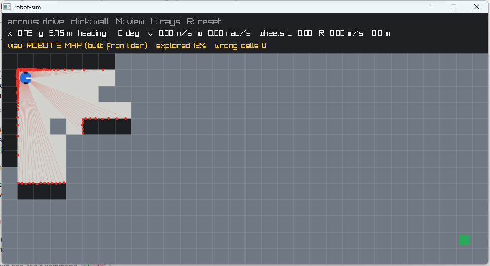

# 3. Mapping: an occupancy grid from noisy scans

Code: [`src/occupancy_map.hpp`](../src/occupancy_map.hpp), [`src/occupancy_map.cpp`](../src/occupancy_map.cpp) ·
Tests: [`tests/test_mapping.cpp`](../tests/test_mapping.cpp)

*White = sure it is free, black = sure it is a wall, grey = never seen (the RViz convention).*

## Why not just keep the hit points?

1. **Noise smears walls** into thick bands of points.
2. **Hit points only say where something is**, never where nothing is. A planner needs three
   states per cell — free, occupied, **unknown** — and the free-space information is in the beam's
   path, not its end.
3. **Mistakes would be permanent**: one bad reading = a phantom obstacle forever.
4. **The world changes**: a moved box would never disappear from the map.
5. **Memory grows forever**: 900 points/s; a grid has a fixed size.

## The occupancy grid

Each cell holds a **belief** that it is occupied. For every beam:

- the cell where it **ended** gets a *hit* (more likely a wall),
- every cell it **passed through** gets a *miss* (more likely free).

### Log-odds

Beliefs are stored as **log-odds** `l = log(p / (1 − p))`. Bayes' rule for combining independent
readings then becomes **addition**:

| | log-odds | probability |
|---|---|---|
| unknown | 0 | 50% |
| a hit adds | +0.85 | (one hit alone: 70%) |
| a miss adds | −0.41 | (one miss alone: 40%) |
| caps | −2.0 … +3.5 | 12% … 97% |

**The caps** keep the map able to change its mind: a wall seen a thousand times would otherwise
need a thousand misses to disappear. With the cap, a removed obstacle clears in about 11 scans
(~2 s). (Test: *"a removed obstacle fades from the map"*.)

**Classification** needs at least **two** agreeing votes either way: occupied above +1.2, free below
−0.62. One hit or one miss leaves a cell unknown. A real wall gets dozens of hits within a second,
so nothing is lost; a one-off glitch cannot become a wall.

## Details that turned out to matter

Each of these was found by a failing test (see the [engineering log](engineering-log.md)).

**One vote per cell per scan, by majority.** Near the robot dozens of beams of the same scan cross
the same cell. They are one look at the world, not independent evidence; counting each separately
made a single scan 100% certain. Each scan therefore counts hits and misses per cell and gives the
cell **one** vote — hit if hits ≥ misses. A real wall is never passed through, so it wins easily; a
free cell that one stray beam ended in is outvoted by all the beams that crossed it.

**Surface tolerance (±5 cm).** In this simulator walls lie exactly on cell boundaries, so with
±1.5 cm noise about half the readings of a wall end just *in front* of it, in the free cell — walls
would grow a cell thicker. The surface is somewhere within ±5 cm of the reading; surfaces are where
the beam **enters** a new cell, so the hit goes to the cell whose entry point is **closest** to the
measured distance. Cells outside the map cannot be the surface (they are not part of the map).

**No return = no vote.** A beam with no reading could mean "nothing within range" or "the sensor
failed on a surface right there" (a dropout). Letting it clear cells out to max range erased real
walls behind the gap, so it does not vote at all. Trade-off: cells crossed only by out-of-range
beams stay unknown until the robot gets closer.

**Usable range (2.5 m of 3.5 m).** Far away few beams reach each cell, and in corridors they skim
walls at a shallow angle, where noise can pick the wrong cell. Beyond 2.5 m a beam only marks the
cells it crossed (up to 2.5 m) as free; its hit is ignored. GMapping calls this `maxUrange`.

## Simplifications

- The map has the same size and cell layout as the world, and the robot knows its true pose.
  Real SLAM must also estimate the pose (next stage: localization).
- The lidar sits at the robot's centre.
