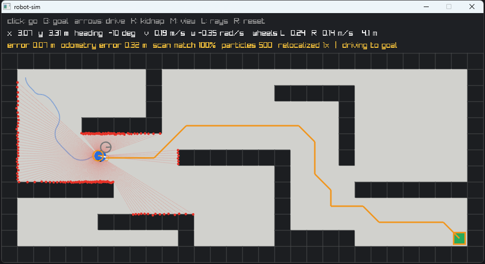

# 5. Localization: knowing where you are when the wheels lie

Code: [`src/odometry.hpp`](../src/odometry.hpp), [`src/particle_filter.*`](../src/particle_filter.hpp) ·
Tests: [`tests/test_localization.cpp`](../tests/test_localization.cpp)

Run it: `robot_sim --localize --go` (roughly knows where it starts) or `robot_sim --global --go`
(no idea where it starts). Press **K** to kidnap the robot.

*Blue: the true robot. Grey outline: odometry. Orange outline: the particle filter's estimate.
Purple: the particles.*

Until stage 4 the robot knew its exact pose. Real robots never do.

## Odometry drifts

A real robot measures how far each wheel turned (wheel **encoders**) and integrates that with the
kinematics from [stage 1](01-motion.md): **odometry**, or dead reckoning. Here the simulated wheels
are slightly wrong, as real ones are:

- the left wheel is 0.5% larger than the software assumes and the right one 0.5% smaller,
- every step each wheel slips by a random ±5%.

The encoders report the motor speeds; the ground moves a little differently. Random slip partly
averages out, but the size error does not: it bends every straight line into a gentle curve, and
heading errors turn into position errors that grow with distance. After a warehouse run odometry
is typically 4–5 m off.

`Odometry` uses exactly the same exact-arc integration as the robot (`integrateArc`), so with
perfect wheels it matches the truth to 1e-9 m: all the drift comes from the wheels, none from
the maths.

## Monte Carlo localization (a particle filter)

The robot has a **saved map** (as if from an earlier mapping run — ROS's `map_server`). It keeps
hundreds of guesses of its pose, **particles**, and after each scan:

1. **Predict.** Move every particle by the change in odometry since the last update, each with its
   own random error. The odometry change is described as *turn, drive, turn* (rot1, trans, rot2);
   the error of each part grows with the size of the moves (`alpha1..4`, *Probabilistic Robotics*
   table 5.6). Without scans the cloud spreads out: uncertainty grows when driving blind.
2. **Correct.** Weigh each particle by how well the scan fits the map **from that particle's pose**,
   using the **likelihood field**: for each beam, look up the distance from its end point to the
   nearest wall surface; close = likely. 36 of the 180 beams are used; weights are computed as
   log-likelihoods (a product of 36 small numbers underflows).
3. **Resample.** Draw a new set in proportion to the weights (low-variance resampling: one random
   number, then evenly spaced picks).

The **estimate** is the weighted mean of the particles near the best one (a plain mean would land
between two clusters), with angles averaged as unit vectors (179° and −179° average to 180°).

### The distance field

Distances to the nearest wall surface are precomputed once per map on a 5 cm grid (AMCL does the
same), so weighing a particle is 36 table lookups. That is what makes 6000 particles affordable:
the whole localization test suite (40 full runs) takes about 10 seconds.

The distance is to the wall's **surface**: from free space, to the nearest wall cell; from inside a
wall, to the nearest free cell (a real beam cannot end deep inside a wall). Outside the map is
**not** a wall — nothing is known there — so it gets the maximum distance.

## Finding itself, and recovering when lost

- **Adaptive particle count.** 6000 particles spread over the whole free map while searching, 500
  once the cloud is tight (spread under 0.3 m). AMCL adapts its count too (KLD-sampling).
- **Health check (scan match).** After each update, every beam is **ray-cast on the map from the
  estimate** and its expected range compared with the measured one. Correctly localized, 95–100%
  match within 15 cm. Unlike the likelihood field, this uses the free space along each beam.
- **Re-localization.** If the filter is confident but fewer than 85% of beams match, for 10 updates
  in a row, it is confidently wrong: it starts a global search again (6000 particles everywhere).
  Nav2 can trigger the same in AMCL (`reinitialize_global_localization`).
- **Do not navigate while lost.** Until the filter is healthy (confident and matching), the robot
  turns on the spot instead of driving, like Nav2's spin recovery. This gives the filter new views
  without driving somewhere based on a wrong belief.
- **Only update after moving** (AMCL's `update_min_d` / `update_min_a`: 0.1 m / 0.15 rad). A robot
  standing still sees the same scan over and over; weighing particles by it again and again
  collapses the cloud onto one point.

## Results

Measured over 30 noise seeds each, with the robot acting only on its own estimate:

| Scenario | Result |
|---|---|
| Tracking while odometry drifts 4–5 m | 30/30, worst error 10.5 cm |
| Finding itself with no starting guess | 30/30, slowest 23 s |
| Recovering after being kidnapped | 30/30, slowest 9 s |
| Navigating both maps on the estimate (maze: 7 cm to spare) | 10/10 per map in the test suite, 0 bumps |

Getting there took several wrong turns; see the [engineering log](engineering-log.md) entries 13–18.

## Simplifications and what is next

- The map is given. Mapping and localizing at the same time is **SLAM** (e.g. a particle filter
  whose particles each carry a map — FastSLAM / GMapping — or scan matching with pose graphs —
  Cartographer, slam_toolbox).
- The lidar sits at the robot's centre (no `base_link → laser` transform).
