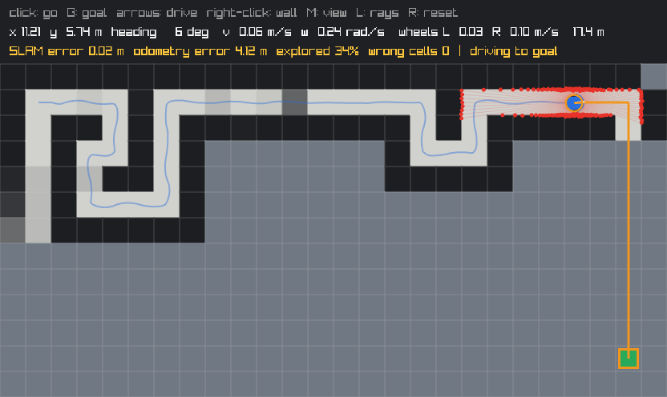

# 7. SLAM: building the map and finding yourself in it at the same time

Code: [`src/slam.hpp`](../src/slam.hpp), [`src/slam.cpp`](../src/slam.cpp) ·
Tests: [`tests/test_slam.cpp`](../tests/test_slam.cpp)

Run it: `robot_sim maps/maze.txt --slam --go`

*The maze after 100 s with no map and slipping wheels. The map is SLAM's own (0 wrong cells);
the SLAM estimate (orange outline) is 2 cm from the true robot (blue), while odometry is already
4.1 m off, outside the picture.*

Stage 3 built a map but assumed the robot knew its pose; stage 5 found the pose but assumed a map.
A robot in a new building has neither. Mapping with a drifting pose smears the map; localizing on
a smeared map gives a wrong pose. **SLAM** does both together.

## The method: a Rao-Blackwellized particle filter (as in GMapping)

Every particle is a complete hypothesis: **a pose and its own map**, built as if that particle's
path were the truth. After the robot has moved, for every particle:

1. **Predict** with the odometry motion model (as in localization), with noise.
2. **Scan-match** the new scan against the particle's own map: hill climbing in x, y and heading
   (try a small step each way, keep improvements, halve the step when none helps). This corrects
   most of the odometry error *before* the scan is added.
3. **Weigh** the particle by how well the scan fits its map at the matched pose.
4. **Add the scan** to the particle's map from that pose (the occupancy-grid mapping of stage 3).

When the weights become uneven, **resample**: good histories are copied, *maps included*; poor ones
disappear. The estimate and the map shown are those of the best particle. ("Rao-Blackwellized"
because the map is computed exactly given the path, so only the path needs sampling.)

## What made it work

| Problem | Cause | Fix |
|---|---|---|
| The estimate lagged behind the robot when exploring (mean final error 0.42 m) | Beams pointing ahead ended where the particle's map had never looked and scored as bad fits; sliding the pose backwards moved them into mapped space and "improved" the fit | Beams ending in never-observed cells carry no information and are **skipped** (GMapping only scores against known cells). Mean final error → 0.03 m |
| Drift along featureless stretches (worst 0.65 m) | The **corridor problem**: along a long open stretch a scan constrains the distance to the side walls and the heading, but not how far along you are, so the matcher moved freely in that direction | An **odometry prior** in the matching score (moving away from the odometry prediction costs (d/σ)²/2, σ = 3 cm), with motion noise **calibrated** to the real odometry (≈4.5%, not 22%). Worst error → 0.07 m |
| A false wall blocked the only path for ever | Grazing beams in a 1-cell corridor created weak false walls (log-odds 1.3–1.7, real walls saturate at 3.5); the robot stopped, and SLAM only updated after moving | Maps still take scans when the robot is **really standing still**; and if no path exists, the planner retries treating **weak walls** as passable at a high cost (like Nav2's *clear costmap* recovery): the robot gets a proper look and the map corrects itself |

Details and the measurements behind each are in the [engineering log](engineering-log.md) (19–23).

## Results

Slipping wheels (odometry drifts 2–3 m), no map, measured on seeds not used for tuning:

| | Without SLAM (mapping from odometry) | SLAM |
|---|---|---|
| Wrong cells in the map (warehouse, 30 runs) | 49–60 | 1.7 on average |
| Wrong cells in the map (maze, 30 runs) | 27–47 | 0.0 |
| Pose error, worst moment of a 150 s patrol | 2–3 m by the end | 0.07 m |
| Exploring to the goal on its own estimate (20 runs per map) | — | 40/40, no bumps |

## Simplifications

- The map's size is known in advance (real SLAM grows the map).
- 30 particles with full map copies works for these small maps; real implementations share map
  memory between particles or use pose graphs (Cartographer, slam_toolbox) for large areas.
- Loop closure happens implicitly (particles with consistent maps survive), not by explicit
  place recognition and graph optimisation.
